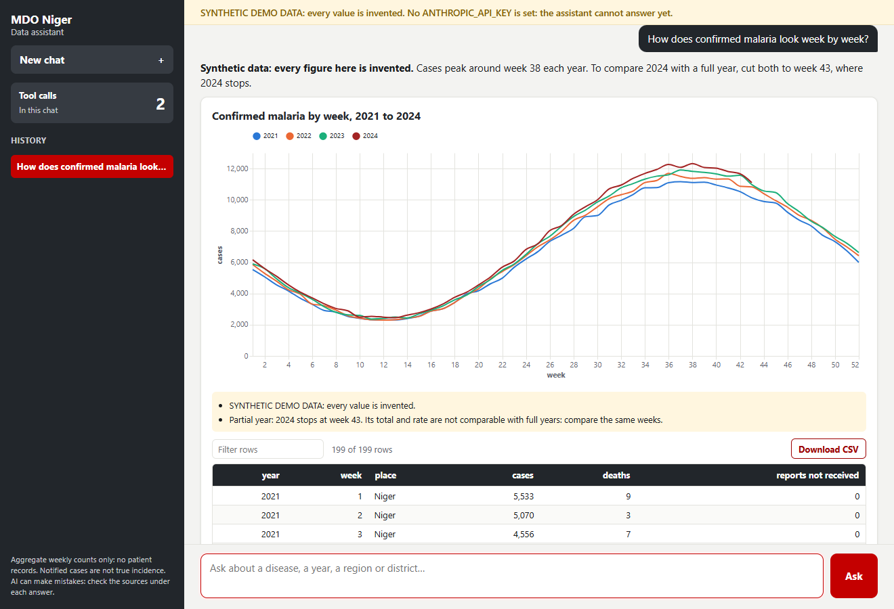
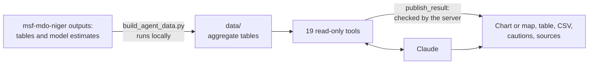
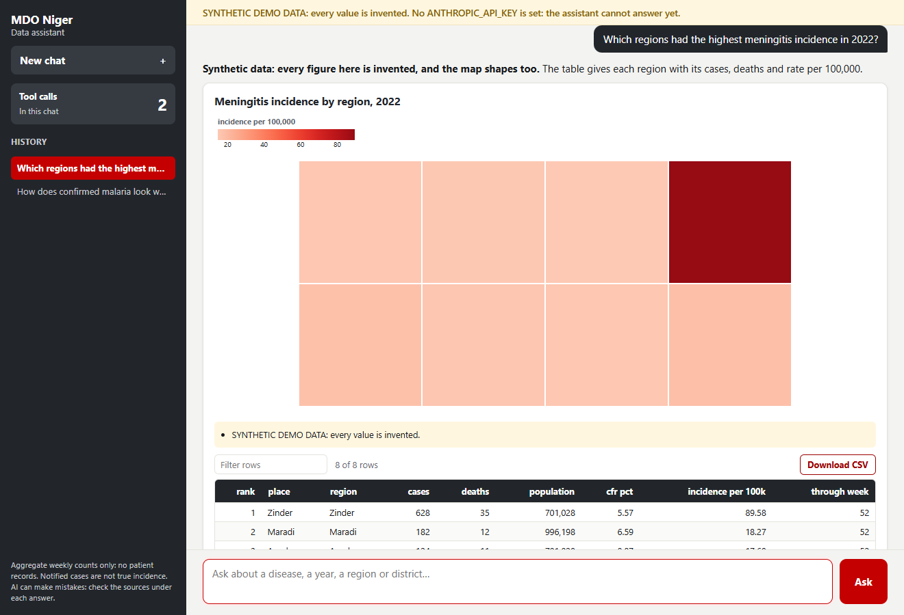

# MDO Niger assistant

Ask, in plain English or French, what Niger's weekly notifiable disease surveillance shows. Every answer comes with its table, a chart or map when it helps, a CSV download, the cautions that apply, and the tool calls behind it.

> *How does confirmed malaria in 2024 compare with 2023, up to the same week?*
>
> *Quels districts ont dépassé le seuil épidémique de méningite en 2024 ?*
>
> *Has diphtheria really increased since 2017? Give the model estimates with their confidence intervals.*

It is the AI companion of [msf-mdo-niger](https://github.com/Abson-dev/msf-mdo-niger), which turns the yearly surveillance workbooks into clean tables, a dashboard and statistical models. This repository holds code and documentation only: the data stay out of it.



*Invented data and a scripted reply, as in every screenshot here.*

> **Status: tested offline, not yet with the live model.** The tools, the web app, the build and the security rules are tested, and the request format is checked through the real Anthropic SDK against a fake API. The quality of the model's own answers is not known, because no API key has been available. Run [the evals](#test-it) before relying on it.

## Try it in two minutes

No surveillance data and no API key are needed to see the tools work on an invented system. You need Python 3.11 or [conda](https://conda-forge.org/download/).

```bash
git clone https://github.com/Abson-dev/mdo-niger-assistant
cd mdo-niger-assistant
python -m venv .venv && source .venv/bin/activate    # Windows: .venv\Scripts\activate
pip install -r requirements.txt

python demo/make_demo_data.py                        # invented tables in demo_data/
export MDO_AGENT_DATA=demo_data                      # Windows PowerShell: $env:MDO_AGENT_DATA="demo_data"

python mdo_cli.py list
python mdo_cli.py compare_years disease=measles year_a=2023 year_b=2024
python mdo_cli.py rank_places disease=meningitis year=2022
```

To chat with it, add an [Anthropic API key](https://console.anthropic.com) as `ANTHROPIC_API_KEY` and run:

```bash
MDO_AGENT_ALLOW_UNLOCKED=true python web/app.py      # then open http://127.0.0.1:8020
```

Everything from the invented system is labelled synthetic, in the tools and in the web app.

## How it works



The model chooses which tools to call and which columns and chart type to show. It writes no code that runs and cannot change any file.

| Rule | How it is enforced |
|---|---|
| **Numbers come from tools** | The instructions forbid estimating, and each answer lists its tool calls. |
| **2024 is never compared with a full year by accident** | `compare_years` cuts both years to the same week, `through_week` does it for a trend, and the server refuses a line over years that ends on a partial year. |
| **Cautions cannot be dropped** | Each tool attaches its own: the malaria definition change, districts before 2017, missing years. The server shows them under the table, whatever the model writes. |
| **Missing is not zero** | A district report not received has empty cases, and weekly tables count the reports not received. A year with no data returns "no data", not 0. |
| **One denominator** | Every rate uses total district population from the measles sheet, as in the project's models. |
| **No unsupported ratio** | Expected live births are dropped in the build, so no maternal mortality ratio can be computed from unchecked figures. |
| **Text from the model cannot run** | The browser inserts it as text; a strict Content-Security-Policy forbids outside scripts, and nothing is loaded from outside the app. |
| **Each question is bounded** | 12 tool rounds, 180 seconds and 500 rows, in [`limits.json`](limits.json). |
| **Access is controlled** | The app listens on this computer only by default and refuses to start on a reachable host without a password. |

**The sources hold no patient records, but sub-national counts are sent to the Anthropic API when a question needs them. Agree this use with the data owners before using the assistant on the real data or sharing it.** Chat history stays in the user's browser and can quote those values.

## Three ways to use it

| Way | Needs | For |
|---|---|---|
| **Web app**: `run_web.bat` (Windows) or `python web/app.py` | `ANTHROPIC_API_KEY` | Chat, charts, maps, tables, CSV |
| **Command line**: `python ask.py "..."` | `ANTHROPIC_API_KEY` | One question, or interactive |
| **Skill**: [`skill/SKILL.md`](skill/SKILL.md) with `mdo_cli.py` | An assistant that loads skills, such as Claude Code | The same tools from the assistant you already use |

Anyone can also run the tools directly with `python mdo_cli.py`, with no API key.

## What it can answer

| About | Tool | Gives |
|---|---|---|
| **What exists** | `list_diseases`, `list_years`, `list_places` | The 25 series, the coverage of each year, regions and districts |
| **Counts and rates** | `get_year_overview`, `get_disease_trend` | Cases, deaths, incidence and case fatality: national, by region, by district |
| | `get_weekly_curve`, `get_seasonality` | Weekly curves, and the usual season with its peak week |
| | `rank_places`, `compare_years` | Rankings, and like-for-like comparisons of two years |
| | `get_malaria_testing` | Tests, positives and positivity, 2015–2020 |
| **Surveillance** | `get_meningitis_alerts` | Districts over the WHO thresholds, by week, district or year |
| | `get_reporting` | Completeness and timeliness of reports |
| | `get_maternal_deaths` | Deaths notified and investigated, 2015–2021 |
| | `compare_dhis2_2024` | The DHIS2 extract against the workbook |
| **Trust in the data** | `get_validation_checks`, `search_data_notes` | Cross-checks against the source files; documented definitions and breaks |
| **Models** | `list_model_results`, `get_model_result` | Rate ratios with confidence intervals, seasonality, spread, forecast validation, case fatality, outbreak alarms |
| **The reader** | `publish_result` | The checked table and chart under the answer |



**It cannot:** forecast coming weeks, explain why a series moved, go below the health district, separate ages or sexes, or say anything after 2024 week 43. Notified cases are not true incidence. It says so rather than guess.

## Use it on the real data

This needs the project's outputs and the data owners' agreement.

1. **Environment.** The assistant has its own conda environment, `mdo-agent`, separate from the project's `mdo-niger`:
   ```bash
   conda env create -f environment.yml
   conda activate mdo-agent
   ```
2. **API key**, from <https://console.anthropic.com>. Keep it out of files:
   ```powershell
   setx ANTHROPIC_API_KEY "sk-ant-..."     # Windows, then open a new terminal
   ```
3. **Project.** Keep [msf-mdo-niger](https://github.com/Abson-dev/msf-mdo-niger) next to this folder as `MDO - Niger`, or set `MDO_NIGER_PROJECT` to its path. Run its pipeline (`rebuild_data.bat`) and, for the model tables, `analysis/run_models.R`.
4. **Tables** (a few seconds; rerun after any change in the project):
   ```bash
   python build_agent_data.py
   ```
5. **Start**: `run_web.bat`, or `python web/app.py` with `MDO_AGENT_ALLOW_UNLOCKED=true`.

On a server, always set a password and put HTTPS in front of it: `APP_PASSWORD=... HOST=0.0.0.0 python web/app.py`.

| Setting | Default | Meaning |
|---|---|---|
| `ANTHROPIC_API_KEY` | none | Needed for the model |
| `APP_PASSWORD` | none | Password of the web app |
| `MDO_AGENT_ALLOW_UNLOCKED` | `false` | No password, on this computer only |
| `HOST`, `PORT` | `127.0.0.1`, `8020` | Where the web app listens |
| `MDO_AGENT_MODEL` | `claude-opus-5-5` | Model |
| `MDO_AGENT_EFFORT` | `high` | `low` to `max`; `medium` costs less and is often enough for look-ups |
| `MDO_AGENT_DATA` | `data/` | Folder of the tables |
| `MDO_NIGER_PROJECT` | `../MDO - Niger` | The project's folder |

The MSF logo is not in this repository. The build copies it from the project when it is there; without it the app runs with no logo.

Each question takes a few tool calls, and the instructions and tool definitions are cached between questions. `ask.py` prints the tokens used; see the [current prices](https://www.anthropic.com/pricing).

## Test it

```bash
pip install -r requirements-dev.txt
ruff check .
python -m pytest                                        # invented system: no data, no API key
MDO_TEST_REAL_DATA=1 python -m pytest tests/test_real_data.py   # the real tables against the project (your computer only)
python evals/run_evals.py --dry-run                     # the eval questions and their expected values
python evals/run_evals.py                               # asks the model each question and grades the answers
```

| Layer | What it checks | Model? |
|---|---|---|
| `tests/test_build.py` | What the build keeps and drops, reports not received, no data can be committed | No |
| `tests/test_tools.py` | Every tool against values recomputed from the tables, including its cautions and error messages | No |
| `tests/test_publish_and_loop.py` | Chart checks and the agent loop with [scripted replies](tests/scripted_model.py), and the real SDK against a fake API | Scripted |
| `tests/test_web.py` | Streaming, password, sessions, limits, startup rule | Scripted |
| `tests/test_browser.py` | The client in real Chrome or Edge under the production security policy: every chart type, injected HTML, CSV, history, phone width | Scripted |
| `tests/test_real_data.py` | Every national series against the project's own table | No |
| `evals/run_evals.py` | 24 questions: the right number, the expected cautions and refusals, the right tools | **Live** |

Only the evals say how good the model's answers are. A full run makes paid API calls, once per question plus its tool rounds. Run them after any change to [the instructions](mdo_agent/system_prompt.md) or the tools.

## Repository

```
├── build_agent_data.py    project outputs -> aggregate tables (the only step that reads the project)
├── ask.py                 command line: questions to the model
├── mdo_cli.py             command line: the tools, no API key
├── limits.json            limits per question and for the web app
├── run_web.bat            starts the web app on this computer
├── mdo_agent/
│   ├── catalog.py         disease names, cautions, model tables
│   ├── data_notes.csv     the documented rules and limits of the data
│   ├── tools.py           the read-only tools
│   ├── results.py         checks what is published
│   ├── system_prompt.md   the instructions: how to read the data, answer style
│   └── agent.py           tool loop, history, token counts
├── web/                   FastAPI server and browser client (Vega served locally)
├── skill/                 the same tools as a skill for any assistant
├── demo/                  the invented system behind the demo and the tests
├── docs/                  screenshots and the script that makes them
├── tests/, evals/         offline tests; live evals
└── data/, demo_data/      generated, not versioned
```

See also [CONTRIBUTING.md](CONTRIBUTING.md), [SECURITY.md](SECURITY.md) and [CHANGELOG.md](CHANGELOG.md). The design follows [ensa-chad-data-assistant](https://github.com/Abson-dev/ensa-chad-data-assistant) and [eurostat-assistant](https://github.com/Abson-dev/eurostat-assistant).
